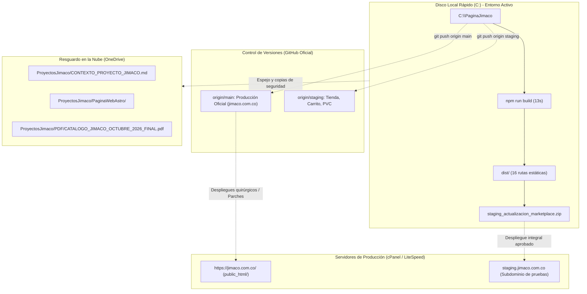

# Contexto Integral del Proyecto: JIMACO (Ferretería Industrial S.A.S.)

> **Empresa:** Ferretería Industrial JIMACO S.A.S.  
> **Lema Corporativo:** «Engranando futuro juntos»  
> **Fecha de Consolidación:** 4 de Noviembre de 2026  
> **Versión del Documento:** 3.0 (Master Unificado)  

---

## 1. Identidad Corporativa y Canales Oficiales

* **Razón Social:** Ferretería Industrial JIMACO S.A.S.
* **NIT / RUES:** Persona Jurídica registrada en Cámara de Comercio de Bogotá.
* **Sede Principal:** Cl. 23 #25-06, Barrio Samper Mendoza, Bogotá D.C., Colombia.
* **Canales de Contacto:**
  * **PBX:** +57 (601) 378 2933
  * **WhatsApp Comercial:** +57 312 3503397
  * **Correo Electrónico:** ventas@jimaco.com.co
  * **Sitio Web en Producción:** `https://jimaco.com.co/`
* **Paleta de Colores Corporativa (Design System):**
  * `Verde Principal / Ultra Oscuro`: `#0B1E02` / `#0A1E0D` / `#0D2614`
  * `Verde Medio Institucional`: `#1C6521` / `#15591C`
  * `Verde Acento / Hover / Neón`: `#7BBE6F` / `#88D67C`
  * `Naranja Acento / CTA Acción`: `#FF6A1C` / `#FF7A2F`
  * `Fondos Claros / Arena`: `#F7F5F0` / `#F8F7F3` / `#E8F0E6` / `#FDFDFD`

---

## 2. Arquitectura de Espacios de Trabajo y Repositorios

Para resolver y prevenir definitivamente problemas de sincronización en OneDrive y errores de bloqueo de archivos `EPERM` en Windows:

### A. Repositorio Oficial en GitHub
* **URL Remota:** [`https://github.com/raulji0910/PaginaWebJimacoAstro.git`](https://github.com/raulji0910/PaginaWebJimacoAstro.git)
* **Estrategia de Ramas (GitFlow):**
  1. **Rama `main` (`origin/main`):**
     * Refleja **exactamente** lo que está publicado y corriendo en vivo en el servidor de producción (`https://jimaco.com.co/`).
     * Último commit: `92a014b` (*«fix(solar): Actualizar fotografias de tuberia PEAD Conduit en suministros de energia solar»*).
     * **Regla estricta:** No se suben cambios experimentales o no autorizados de la tienda virtual a esta rama.
  2. **Rama `staging` (`origin/staging`):**
     * Rama de integración continua y staging.
     * Contiene todos los módulos nuevos desarrollados: Carrito flotante, Tienda/Marketplace, Landing interactiva de PVC, Consola admin.
     * Último commit: `fb326bb` (*«feat(staging): Integracion de Marketplace, Carrito flotante y Landing interactiva de PVC»*).

### B. Directorio de Compilación Local Activo
* **Ruta Física:** `C:\PaginaJimaco`
* **Tecnología:** Astro 4.15+, Tailwind CSS 3.4+, TypeScript / Vanilla JS.
* **Comando Dev:** `npm run dev -- --host 127.0.0.1 --port 4321` (Puerto `4321`).
* **Comando Build:** `npm run build` (Compila 16 páginas estáticas en ~13 segundos).
* **Paquete de Distribución:** `C:\PaginaJimaco\staging_actualizacion_marketplace.zip` (54.66 MB, 271 archivos).

### C. Directorio Espejo y Documentación (OneDrive)
* **Directorio Espejo:** `C:\Users\Lenovo\OneDrive\Documentos\Personal\ProyectosJimaco\PaginaWebAstro`
* **Directorio Maestro de Archivos:** `C:\Users\Lenovo\OneDrive\Documentos\Personal\ProyectosJimaco`
* **Propósito:** Resguardo en nube, copias de seguridad, catálogo digital PDF, cotizaciones y bitácoras.

### D. Servidor Web de Producción (cPanel / LiteSpeed)
* **URL:** `https://jimaco.com.co/`
* **Host / Servidor:** LiteSpeed Web Server en cPanel (`s3452.mex1.stableserver.net:2083`).
* **Usuario:** `jimacoco` | **Ruta Raíz:** `/home/jimacoco/public_html`.

---

## 3. Arquitectura del Sitio Web Astro y Módulos Desarrollados

El sitio compila 16 rutas estáticas optimizadas para velocidad extrema (99+ PageSpeed), accesibilidad y SEO técnico.

### 🏠 1. Página de Inicio (`/` - `src/pages/index.astro`)
1. **`HeroSlider.astro` (Slider Principal de 4 Diapositivas):**
   * **Slide 1:** `JIMACO estará en ExpoSolar Colombia 2026` (`NoticiaExposolar.png`), badge de fechas (28-30 Octubre 2026, Corferias) y CTA `Ver más →`.
   * **Slide 2:** `Soluciones industriales que impulsan el futuro`.
   * **Slide 3:** `Estamos en el negocio de la energía limpia`.
   * **Slide 4:** `Crecemos cuando juntos cuidamos del talento humano`.
2. **`SupplyThreeBoxes.astro`:** 3 tarjetas destacadas flotantes (Energía Fotovoltaica, Construcción, EPP).
3. **`SuministrosHeaderNumber.astro`:** Cabecera `+1.260 Productos` / `Tres líneas, una misma promesa: eficiencia y confianza`.
4. **`HorizontalSuppliesCarousels.astro`:** Pestañas interactivas y carruseles por categoría de productos.
5. **`NuestraEsencia.astro`:** Titular *«Engranando futuro juntos, impulsando el desarrollo»*, texto corporativo y fotografía panorámica real del **Campo Parex** con punto naranja.
6. **Ticker Animado 1:** Marquee continuo infinito `Calidad . Relación . Confianza .`
7. **`LlegandoLejosMap.astro`:**
   * Fondo verde oscuro `#0A1E0D`.
   * Contador gigante en verde neón: **`+460`** `Clientes satisfechos`.
   * Silueta del Mapa de Colombia con 5 pines interactivos con coordenadas costeras exactas (Bogotá, Medellín, Barranquilla/Costa, Casanare/Llanos, Cali/Valle).
8. **`GalleryScrollBanner.astro`:** Galería continua animada en auto-scroll de 10 imágenes reales de suministros y proyectos en obra.
9. **`HistoryFeriaSection.astro`:** Sección *Fundada en 2013* con fotografía oficial del stand de JIMACO en la Feria Solar.
10. **`PortafolioSolutionsSection.astro`:**
    * Ticker superior: `Asesoría . Eficiencia . Cumplimiento .`
    * Ondas curvas de fondo (`vertical-waves.png`) y 3 filas con enlaces directos (`Conocer productos →`, `Conocer herramientas →`, `Conocer los insumos →`).
11. **`ThreeProjectsJoinedGallery.astro`:** Galería panorámica en 3 columnas anchas (Granja solar, Construcción y Tubería metálica galvanizada).
12. **`ProjectsShowcase.astro`:** Granjas Solares Celsia destacadas (Flandes, Dulima y Yuma).
13. **`SloganBanner.astro`:** Franja institucional gigante *«Engranando futuro juntos»*.
14. **`MetricsGrowth.astro`:** Tarjetas verdes con iconos metálicos 3D (`+10 AÑOS`, `+46 CLIENTES`, `1257 PRODUCTOS`).
15. **`CommercialTeamBanner.astro`:** Fotografía oficial del equipo comercial de asesoras (`fondo-cta-jimaco.jpg`) + CTA crema `Contáctanos ahora →`.
16. **`BrandLogosBorderGrid.astro`:** Cuadrícula desktop en 5 columnas con bordes de 1px (AdlerTec, 3M, Safer, STEELPRO SAFETY, Gerfor, etc.).

---

### 🛍️ 2. Módulo de Tienda Virtual y Carrito Flotante (En rama `staging`)

Diseñado para modernizar la captación de pedidos industriales sin fricción:

1. **`CartDrawer.astro` (Carrito Lateral Flotante):**
   * Panel lateral animado con overlay oscuro accesible desde cualquier página a través del Navbar.
   * Persistencia del carrito en el cliente mediante `localStorage`.
   * Controles de incremento `+`, decremento `-` y eliminación de ítems.
   * Contador de badge dinámico reactivo en el botón del Navbar.
   * **Generador de Cotización a WhatsApp:** Al pulsar «Cotizar Pedido por WhatsApp», genera un mensaje estructurado y codificado con el detalle de los productos, cantidades y envía la consulta al canal comercial (+57 312 3503397).
2. **`ProductCard.astro`:**
   * Tarjeta de producto con imagen optimizada, categoría, título, badge de stock/disponibilidad.
   * Selector interactivo de cantidad predeterminado antes de agregar al carrito.
   * Botón de acción rápida para abrir el modal de detalles.
3. **`QuickViewModal.astro`:**
   * Ventana modal emergente con renderizado de especificaciones técnicas, diámetros/calibres y botón de adición directa.
4. **`src/data/products.ts`:**
   * Estructura de datos TypeScript centralizada con catálogo de referencias por líneas (Energía Solar, Construcción, Protección Personal, Tuberías PVC).
5. **`/tienda.astro` (`src/pages/tienda.astro`):**
   * Marketplace completo con buscador en tiempo real por texto (nombre, SKU o aplicación).
   * Filtros dinámicos por categorías y contador de resultados.
6. **`/admin/index.astro`:**
   * Consola interna preliminar para previsualización y gestión de productos.

---

### 🔧 3. Landing Técnica Interactiva de PVC (`/tuberias-cloruro-de-polivinilo-pvc`)

Implementada siguiendo el estándar interactivo industrial de **ALR Group**:
* **Selectores dinámicos por color y aplicación:**
  1. **Conduit Eléctrica RETIE:** Verde y gris oscuro para canalizaciones eléctricas según NTC 979.
  2. **Presión RDE:** Blanca para conducción de agua potable según NTC 382 y ASTM D1785 (RDE 9, 11, 13.5, 21, 26, 32.5, 41).
  3. **Sanitaria y Aguas Lluvias:** Blanca / marfil según NTC 1087 / NTC 2295.
  4. **Ventilación:** Blanca / naranja liviana.
  5. **Alcantarillado Novafort / Corrugada:** Tubería de gran diámetro interior lisa y exterior corrugada.
* **Tablas de Especificaciones Dinámicas:** Diámetros nominales en pulgadas (1/2" a 12") y milímetros, presiones de trabajo, espesores y longitudes estándar (3 m y 6 m con unión mecánica o campana soldable).
* **Certificaciones y Sellos:** RETIE, NTC 979, NTC 382, NTC 1087, ASTM D1785, ASTM D2241.
* **Cotizador Multi-Asesor:** Envío inmediato de especificación requerida al WhatsApp comercial.

---

### 🏢 4. Páginas Institucionales y de Suministros

* **`/sobre-jimaco` (`src/pages/sobre-jimaco.astro`):** Hero con video aéreo de drone (`Oficina-Ferreteria-Industrial-Jimaco.mp4`), secciones «Historia y Propósito», «Visión y Valores» con iconos 3D.
* **`/politica-de-calidad` (`src/pages/politica-de-calidad.astro`):** Misión, Visión, 6 Pilares de Calidad vectoriales SVG y 5 Objetivos de Calidad numerados.
* **`/suministros-de-energia-solar.astro`:** Cables fotovoltaicos, conductores solares, y producto `002 Tubería` con fotos reales (`G-Conduit-2.jpg`, `G-Conduit-5.jpg`).
* **`/suministros-para-construccion.astro`:** Suministros para obra civil, fijaciones, y enlace directo a la ficha interactiva de PVC.
* **`/suministros-para-proteccion-personal.astro`:** EPP, calzado, arneses, cascos y protección auditiva/respiratoria.
* **`/contacto.astro` y `/ponte-en-contacto.astro`:** Formularios y mapa.

---

## 4. Historial de Despliegues y Entregas Relevantes

### 📅 4 de Noviembre de 2026: Sincronización Integral en GitHub (GitFlow)
* **Rama `main`:** Actualizada y sincronizada con el commit `92a014b` conteniendo el parche de fotos PEAD en energía solar correspondiente a la web en vivo (`https://jimaco.com.co/`).
* **Rama `staging`:** Creada y publicada en GitHub (`fb326bb`) conteniendo todo el desarrollo de Marketplace, Carrito de compras (`CartDrawer`), landing de PVC y consola admin.

### 📅 29 de Octubre de 2026: Catálogo Técnico Digital PDF JIMACO
* **Archivo Generado:** `C:\Users\Lenovo\OneDrive\Documentos\Personal\ProyectosJimaco\PDF\CATALOGO_JIMACO_OCTUBRE_2026_FINAL.pdf` (103 páginas, 16.34 MB).
* **Precios:** 1.555 precios actualizados con incremento comercial del **+25% redondeado al millar más cercano**, preservando intactas las especificaciones de fábrica (frecuencias, cuentas, rangos).
* **Identidad de Marca:** Logo horizontal corporativo en portada y páginas 2-103, colores verde institucional (`#1C6521` y `#7BBE6F`) y datos de contacto de la web.

### 📅 27 de Octubre de 2026: Actualización Producción Tubería 002
* **Página Afectada:** `https://jimaco.com.co/suministros-de-energia-solar`
* **Cambio:** Sustitución de imágenes del producto `002 Tubería` por fotos reales de obra (`G-Conduit-2.jpg` y `G-Conduit-5.jpg`).
* **Despliegue:** Parche selectivo a `public_html/` protegiendo la producción de la tienda en desarrollo.

---

## 5. Procedimientos y Protocolos de Operación

1. **Compilación y Servidor Local:**
   * Ejecutar siempre desde `C:\PaginaJimaco`.
   * Servidor dev: `npm run dev -- --host 127.0.0.1 --port 4321`.
   * Servidor build: `npm run build`.
2. **Procesos en Segundo Plano Protegidos:**
   * **NUNCA** terminar el proceso de Node correspondiente a Angular (`C:\dev\node14\node.exe` en puerto 4310).
3. **Flujo de Publicación a Producción:**
   * Mientras la tienda virtual no esté finalizada y aprobada por gerencia de JIMACO, cualquier actualización en la web en vivo debe realizarse mediante **parches quirúrgicos** sobre `public_html/` y commitearse a la rama `main`.
   * Las pruebas globales deben montarse en un subdominio de staging (`staging.jimaco.com.co`) usando la rama `staging` o el archivo `staging_actualizacion_marketplace.zip`.

---
*Documento consolidado y actualizado el 4 de Noviembre de 2026.*
